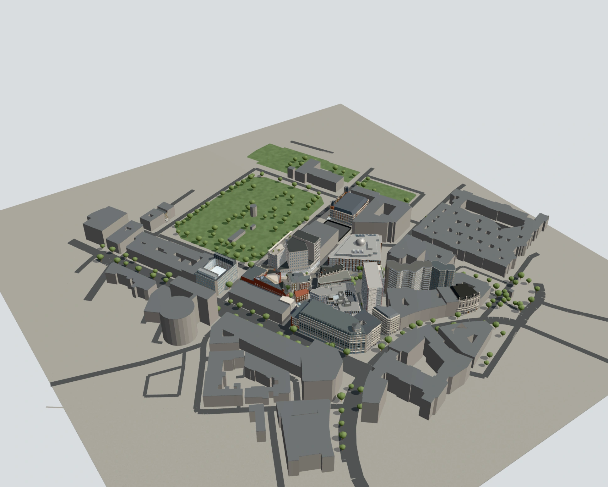

# LSEmap

An interactive architectural study of the London School of Economics campus.

[Explore the campus](https://lsemap.xhr0316.workers.dev/)

## Current model

Edition259 contains31 building records,30 detailed exteriors,25 interior views
and35 selectable room studies. The complete editable campus is
kept locally at `result/blender/LSE_campus_detailed_v259.blend`. GitHub contains
the current browser models, presentation assets and authoring/export scripts.
The local `stage259` acceptance records are retained with the native: integration
and export compare loaded objects with the accepted fingerprint snapshots before
writing a release.

The overview and selected-building views share authored exterior objects,
finishes and public structural elements. All206 gallery images use the
production viewer, explicitly capture its settled four-sample output and are
checked against model and renderer signatures.

The campus, building and room views share direct drag-to-pan, with right-drag or
Shift-drag to orbit. There are no navigation mode buttons. One finger pans; two
fingers drag to orbit and pinch to zoom.
Foreground models request high network priority; background exterior refinements
request low priority while retaining the same integrity checks and idle decoding.
Room entry and detail presentation reuse the same prepared scene when their asset
URL matches. Switching rooms aborts obsolete entry/detail transfers; late decoder
results are released without blocking or overwriting the current selection.
Background exterior refinements pause inside a room and resume in the campus.
Labels pass drag gestures to the map while stationary taps and keyboard activation
still select the building. Wheel zoom and the start of a touch pinch use the actual
surface distance, so a nearby facade can be approached without crossing it or
stalling at the former campus pivot. One surface query is reused throughout each
wheel burst. Horizontal trackpad gestures and Shift wheel pan; toolbar zoom uses
the visible centre surface. Exterior navigation stays above street level while retaining upward
facade views; interior cameras keep their full range. Below the true horizon,
neutral atmospheric distance blends with the district edge.

Edition259 restores eight photographed Houghton window boxes on the retained
Old Building window axes and stone sills. Three shared meshes reuse existing
finishes; dimensions, foliage and the undated seasonal condition remain estimates.
The library exterior exporter now resolves the current public interior collection
from metadata or its semantic role, preventing underground carpet from appearing
as a blue strip beneath the isolated building. Native and interior-view underground
levels are retained. Original architecture, materials and35room studies are protected.
CBG shade-to-window registration remains open; the available source evidence does
not justify a complete speculative re-spacing of its facade assemblies.

Edition258 aligns the library’s Watkins Plaza frontage with its2025 existing
elevation: the historic stone and modern brick divisions, broad windows, Library
portal and visible roof edges follow the three actual GIS boundary segments.
Existing glass finishes and the upper roof and dome are retained. Concealed roof
returns and the source-to-GIS fit remain estimates; the independent low service
annex is excluded where its footprint is not established.
Marshall’s north fins use the documented slightly darker tone than their backing
panels. Its registered third-floor deck retains the original top UVs and three
shaft holes, with a closed section and corrected upward top normals. The0.32m
thickness is an inherited estimate; higher-floor coordination remains incomplete.
All35independent room studies and unrelated architecture are protected.

Edition257 restores the yellow lower face of Pethick-Lawrence’s entrance
canopy, using its existing yellow finish. The Old Curiosity Shop’s three upper
sashes now have the photographed four rows rather than five; the original
thicker meeting rails sit at mid-height. Lincoln Chambers’ fanlight lettering
follows the arch above the number3, with the original contours seated close to
the retained glass. Photographic proportions remain estimates. Existing glass
finishes, all35room studies and unrelated architecture are protected.

Edition256 corrects King’s Chambers portal lettering to a shallow photo-guided
arc and seats the title and retained-size door numbers close to the green mosaic.
Pankhurst’s entrance mesh uses horizontal diamond apertures with continuous
internal joints. Its shared forecourt gains grey stone planter seating in place
of generic metal boxes and raised timber benches. Three exterior approaches
are checked for furniture clearance; closed-door and threshold traversal is not
proved. The wrong-side bicycle proxy is archived, with its actual replacement
location still unregistered. Historical photographs guide these estimates;
all35 room studies and the existing glass finishes are retained.

Edition255 restores Sheffield Street's photographed lower blind panel in place
of two unsupported windows, and removes the continuous stone belt incorrectly
repeated across Cowdray's short street side. Internal brick-head joint bevels
are cancelled locally to close previously concealed corner slots. Other window geometry, glazing,
roofs and all35 room studies remain unchanged. Two close gallery views expose
the corrected facades. Dimensions and unpictured elevations remain estimates.

Edition254 corrects the opaque Three Tuns entrance pane by reusing the accepted
SAW Denning glass family with browser opacity0.30 and no screen-space refraction.
The original pane geometry, timber, lettering, walls and historical floor plan
remain intact. All30 exteriors,25 default interiors and34 other room studies
are unchanged. This remains a partial historical bar entrance, not a complete
or current interior reconstruction; glass optics are an approximation.

Edition252 coordinates COL’s Houghton stone and painted frames with the retained
photo-guided finish family. Uniform stone albedo uses the existing tone study’s
linear mean, avoiding unsupported repeated colour patches. Original geometry,
UVs, glass, roof and global lighting remain unchanged; colour is uncalibrated.
The overview has no decorative scene headline. Building names remain in detail views.

Edition251 integrates the source-registered COL Houghton elevation with64windows,
8opaque ground modules and a closed roof coordinated with both upper window rows.
The2020drawing controls the front outline and eave. Roof rear depth, unpictured
sides and finishes remain estimates; known Aldwych/Garrick architecture is retained.
New copies correct inward trim normals and remove bounded old glazing remnants.
MAR gains two southern third-floor concrete cores and four source-width door gaps.
The17.5/21.9mlevels and2.1mdoor heads remain estimates. The next generic floor
plate is preserved because the source does not independently locate its shaft
boundaries; this is not a full-height lift reconstruction. All35room studies and
2341original material graphs are preserved.

Edition250 corrects OLD’s four external tread corners to the long faceted
outline visible in the completed-project photograph. All original tread heights,
thresholds and rail supports remain, with no added triangles. Corner proportions
remain photographic estimates. MAR’s existing third-floor slab now contains the
three structural lift-shaft openings registered from the2022 built plan. Its
outline, material, UVs, inter-shaft strips, other floors and35room studies remain.
The new third-floor section and gallery view expose these openings directly;
lift cars and the complete third-floor interior remain unbuilt. The walls were added in251.
The inherited17.5m floor datum remains an estimate. The two updates add20triangles.

Edition249 restores the two photographed horizontal grille rails over OLD’s
Houghton entrance doors. Existing leaf hardware, glazing, artwork and all other
architecture remain intact. The18mm rail height,45mm depth and setback are
photographic estimates. A new close view exposes the bounded change.

COL’s72-module Houghton frontage now shares the same accepted source geometry in
the complete campus and selected-building view, with bounded old skin clipping
and saved geometry/UV verification. MAR’s2022 third-floor source has been registered
to the shared lift cores; the outer-boundary disagreement still prevents a
whole-floor or upper-tower replacement.

Edition248 restores the mapped public court enclosure in Lincoln’s Inn Fields.
Sixty coated posts and five wire panels leave the mapped corner entrance open.
Wire coverage is filtered in screen space to retain holes without distant shimmer.
The3m height, post section, wire pitch and generous opening are estimates; the
operator photograph has no verified capture date. Existing paths, trees, courts,
all30building exteriors and all35room studies retain their accepted geometry.

Edition246 registers the89-opening CON Houghton elevation from the2020 existing
drawing, including continuous stone surrounds, recessed glass and a closed roof.
The current footprint, Aldwych entrance, streets and all35room studies remain.
The3.3604% horizontal fit, flat side-door lower bounds and unseen rear roof closure
are authored estimates; this is not a current measured whole-building interior.
COL's72-module frontage was subsequently registered and integrated in251.

Edition243 closes inherited Houghton paving gaps and removes overlapping edge
tops without moving the street, entry steps or bollard bases. Static architectural
transforms are now prepared once rather than recomputed on each navigation frame.

Edition242 coordinates the estimated SAW three-to-four and four-to-five main
stair connections with the actual uncoloured circulation extracted from the
2014guide. Two continuous winding waists, supported rails and local floor
interfaces remove the retained eleven tread/cabin overlaps. The original lower
geometry and fifth-to-sixth ST04 remain. Dedicated stair views preserve coherent
assemblies through both fallback and detailed interior loading. Routes, dimensions,
counts and finishes remain estimates; shaft walls, doors, complete rooms and the
current2026 layout are not established by this historical source.

Edition241 conforms the existing Clement House school-name glyphs to the
curved stone frieze, retaining their font contours, size, height and finish.
A direct inscription view and matching gallery still make the alignment
inspectable. The supporting official handbook was rechecked against the
canonical archive; its photographs remain undated. Lettering depth and extent
are authored estimates, not a measured engraving reconstruction.

Edition239 replaces the five segmented Clare Market relief studies with
continuous shallow bodies, curved limb profiles and joined necks. It retains
the five photographed poses and their positions, existing limestone finish,
blue windows, panels and entrance. Sculpture contours and depths remain
authored interpretations; the unillustrated side panel is not reconstructed.
A direct Clare Market3D view makes the refined frontage inspectable.

Navigation waits for camera inertia to settle before attaching background
models, rechecks late wheel input and gives explicit building selections
priority. Orbit damping follows elapsed time rather than the number of frames
or input events. Wheel bursts use one scene draw per new frame; a single
four-sample still follows the quiet interval, accumulated one scene draw per
animation frame and immediately interruptible by new input. Subpixel inertia is cleared
without moving the visible pose, and held gestures do not redraw unchanged
frames. Canvas resolution and source geometry remain unchanged.

Edition238 corrects the reversed PEL entrance arrangement: the existing revolving
door and posts move to the photographed left side, with the central frame and
side-door pull coordinated. It refines only the photographed front wall faces,
entrance cladding and front glazing. The curved front glass receives finite
transparency while its existing rear opaque proxy stays in place; no complete
lobby is inferred. All original meshes, rooms and other buildings remain.
Desktop close views reserve clear space beside the open directory; closing it
restores the full canvas width.

Edition237 keeps the KGS cupola geometry and separate seams while giving its
lead shell continuous corner normals, and restores photo-guided low planting
inside six existing LSE Square tree pools. The browser samples small bevels
more economically in15named OLD/SAW batches without removing openings or
changing the native source. The later238 layout reserves unobstructed desktop canvas space beside the directory.

Edition236 restores a supported Clare Market entrance landing and two handrail
feet at the Old Building while retaining every tread, door and street level.
Two exact source batches are superseded; all35room studies and the25default
interiors remain byte-identical. Explicit lead and mixed lead/slate finishes
retain their authored roughness and metalness in the shared viewer, covering
six campus buildings and context roofs without changing source geometry or
base colours. Roof coefficients and retained dimensions remain estimates;
current whole-building interiors and every room are still incomplete.
A close view makes the retained King’s Chambers cupola and lead seams inspectable.

Renderer review235 preserved edition234 geometry and every browser-model
checksum before the following geometry revision. Interior views reuse the existing three lights with
bounds-relative bounce and restore the exterior state on exit. Opaque foliage
gains filtered leaf-cluster relief without new meshes, textures or render passes.
Procedural foliage is a presentation estimate. Local desktop and narrow-viewport
comparisons cover four interiors and near/middle/overview planting; they do not
establish physical-phone performance. All193 stills use the updated live renderer.
The library's blue points are the historically sourced Blue Rain artwork;
wall separation and outward normals were checked, so they remain intact.

Edition234 removes49.42square metres of coplanar duplicate asphalt
without changing the road union, levels, remaining source faces or their UVs.
A1mm contact belt retains0.101square metres of existing overlap to avoid
20-bit export cracks. A visible flicker improvement is not claimed.
An independent CKK.1.10 study follows18 historical student chair positions,
a U-shaped table layout, two projecting window bays and a complete ceiling.
All34 earlier room assets,25 default interiors and30 building exteriors retain
their checksums. LRB floor datums, COL upper-elevation registration and the
CKK atrium entry remain unresolved where current sources cannot locate a
supported correction. Full current interiors and every room remain incomplete.

Edition233 gives the library broad windows and Watkins panes finite dielectric
transmission while preserving geometry, frames and existing public interiors.
The Old Building upper attic band restores four low arched blue grilles and
a wide central stone parapet while retaining the mansard and lower facade.
Source-identified park facilities replace the17m closed bandstand proxy and
cafe box with an open timber pavilion and a single-storey roofed envelope at
retained footprints. Mapped hardstanding preserves all paths and three tree
soil circles. SAW gains2 coordinated estimated stair connections,
continuous platforms and slab openings; retained lower lift conflicts decrease
from32 to11. These are useful source-constrained estimates, not an exact
as-built stair reconstruction. All34 prior room assets,24 other default interiors
and27 other detailed exteriors retain their checksums. Whole current interiors
and every room remain incomplete.

Edition232 repairs the library street entrance: a real opening replaces the
continuous base obstruction, with a local landing and three low steps joined
to the retained interior floor. Overview and selected exterior use the same
entry geometry; the default interior asset stays unchanged. Fifty mapped
park trees receive continuous closed crowns without moving trunks or other
planting. OLD.1.27 and FAW.1.03 add historical18-seat and24-seat classroom
studies. All32 previous rooms,25 default interiors and29 other exteriors
retain their checksums. Dimensions and present-day layouts remain unverified.

Edition231 restores four concrete tree containers at the retained Watkins
Plaza tree positions using the official public-realm existing-condition audit.
Paving and unrelated furniture remain intact; dimensions are photographic
estimates. OLD.1.26 adds an independent18-seat group classroom. The existing CON.7.04
default study is rebuilt with a complete enclosure, fixed source seats and an
inside camera. All31 earlier room assets,24 other default interiors and30
detailed exteriors retain their checksums. Historical sources do not establish
current layouts or comprehensive building interiors.

Edition230 adds independent historical CLM.1.02 and KSW.1.02 studies: five
six-person groups with timber wall panelling, and18 individual tablet-arm chairs
with a dual-screen teaching wall. Both retain source seat positions, complete
ceilings and saved-mesh checks for connected full-height approach routes.
Dimensions and current layouts remain unverified. One complete obsolete bench
crossing a stone tree surround is retired after positive-volume verification;
the six unaffected benches, paving and planting are preserved. All29 previous
room assets,25 default interiors and30 detailed exteriors retain their checksums.

Edition229 reduces intrinsic cyan in two SAL historic-window batches at retained
luminance and optical settings. Window geometry, frames, tower glazing and the
entrance pavilion are preserved. Six existing square tree surrounds gain72 stone
pieces and48 recessed joints without changing paving, footprints or heights.
Independent FAW.1.02 and SAL.B.01 studies add24 and20 historical student positions,
continuous ceilings, openings and source-based furniture. Full-height routes
reach all four seating groups; rejected shortcuts remain documented. Dimensions
and current layouts remain unverified. All27 earlier room assets,25 default
interiors and29 other detailed exterior assets retain their checksums. Building
previews choose the matching exterior independently of gallery order; opening
the preview keeps the correct position within the full gallery.

Edition228 adds paired historical MAR.1.08 and CLM.G.03 classroom studies.
MAR follows83 visible seat symbols across tiered horseshoe and grouped tables;
the diagram's printed87 capacity differs by four and is not silently filled.
CLM follows14 tablet-arm student chairs, a teaching station and recessed window
bay. Both include complete ceilings, real apertures and checked furniture
supports. Scale, concealed finishes and present-day use remain unverified.
All25 earlier room assets,25 default interiors and30 exteriors are unchanged.
Mobile room entry now preserves the authored interior eye, places the view
above the bottom sheet and switches scenes directly without an empty camera
flight; residual drag motion is cleared before a new entry pose.

Edition227 removes overlapping asphalt beneath retained stone at the street
contact, eliminating competing coplanar faces while preserving road boundaries
and levels. Original corner UVs are continued across the clipped triangles.
Independent CKK.1.15 and OLD.6.06 studies add complete room shells, openings,
source-supported furniture and continuous ceilings. OLD.6.06 follows its historical
20-seat plan; its reference photograph shows a different table arrangement.
All23 prior room assets and existing building exterior/interior assets remain
unchanged. Dimensions and current layouts remain unverified.

Edition226 adds an independent PAN.2.01 classroom from its paired official
plan and photograph: five triangular tables,30 student seats, a teacher station,
mobile whiteboards, window blinds and a continuous suspended ceiling. The saved
mesh passes ceiling, opening and furniture-support checks. Dimensions are
estimates; the room is not geographically registered to the building floor.
All22 prior room assets,25 default interiors and30 exterior assets are preserved.
LRB floor-edge and Shaw Library source gaps remain unresolved.

Edition225 restores Peacock's three paired entrance doors and photo-supported
shallow street roof frame, preserving all11 glazing solids and their optics.
An independent KSW.2.12 study follows the paired historical plan and photograph:
six collaborative tables,42 plan chair symbols, real door/window openings and
a dual-screen teaching wall. Dimensions and current capacity remain unverified.
All21 prior spaces and25 default interior assets remain unchanged.

The city-context pass now preserves the shared glazing reflection finish instead
of overwriting it with opaque-wall roughness. Source opacity, transparency and
the existing reflection environment remain intact, without extra render passes.

Edition224 replaces the RCS gray street-front proxy with its photo-supported
stone facade,56 rectangular and14 circular backed window openings and six-column
portico. The native campus and browser share26 new context batches;11 exact
originals remain archived. All30 LSE exterior assets,25 default interiors and21
room assets retain their checksums. RCS is a neighboring property, separate from
35L. Unseen rear volumes and roof retain estimated proxy geometry. Reference
photographs stay private; the principal source is the [project architect](https://www.hawkinsbrown.com/projects/the-royal-college-of-surgeons/).

MAR/SAW circulation reviews reject unregistered or obstructed additions. New
source evidence is retained locally without claiming those routes are complete.

Edition223 restores CBG's source-supported LG-G-1-2 academic stair and
connected corridor structure. MAR gains a real second-floor plate with source
voids, column supports and guards. SAW's fifth/sixth-floor connector moves to
the documented spiral-stair location, resolving six old lift conflicts while
32 lower-route conflicts remain. All7688 source objects,2022 material nodes
and21 selectable studies are protected. Public levels now use their authored
inspection cameras; dimensions and complete current interiors remain unverified.

Edition220 adds an isolated Hong Kong Theatre study from the official paired
CLM.G.02 plan and photograph. Its260 historical plan symbols retain the actual
three seating banks, staggered rows and rear recess. Wood panelling, two screens,
central whiteboard, low stage, desk and guarded approach use43,360 triangles.
Scale, height and concealed construction are estimates; no unseen second level,
current capacity or complete geographic floor is inferred. All18 preceding
spaces and25 default interior assets remain unchanged. Room presentation reuses
the existing lights for softer diffuse fill, restoring exact daylight settings
when returning outdoors.

Edition219 refines CKK front glazing and painted frames plus Kingsway glazing
without extra geometry. Inherent cyan/blue casts are reduced at retained linear
luminance; original optics, stone, brick, roof pavilion transparency and rooms
remain. Frame-excluding backing probes do not establish new interiors, so opaque
window proxies are retained. A read-only LRB comparison preserves the accepted
facade and roof; it does not claim a new current measured survey.

Edition218 coordinates Old Building's fixed doorway framing, fine paired-leaf
seams, eight glass panes and existing handles. The Final Sale artwork uses six
photo-guided shallow open-mesh figures, drapery, trolley, baskets and varied goods.
Its four replacement batches use80,132 triangles instead of519,272. The exterior
asset falls from19.89MB to14.84MB; every other building asset, all25 default
interior fallbacks and18 room assets retain their preceding checksums. Depth,
reverse surfaces and photographic dimensions remain estimates, without public
photographic textures or a claim of a scanned sculpture.

Edition217 registers Marshall's ground plan through12 shared lift-core corners
in the architect's built2022 drawings. Three entrance groups with five revolving
doors, nine support positions, the retained main stair, slab openings and guards
are coordinated together. Source and map registration remains approximate;
upper storeys, vertical datums and independent room studies are retained.

Cowdray's brick, pale stone, painted joinery, glass and slate finishes use19
independent materials with no extra geometry. Old Building's16 entrance-window
panes receive a restrained neutral reflective finish while blue frames remain.
Two tunnel-tagged pedestrian routes lose57.64m² of erroneous surface paving,
while their2.61m² overlap with real surface paths remains.

SAW218 circulation remains a rejected source diagnostic, with no new component:
12 same-flight conflicts and an unsupported0.232m fourth-to-fifth corner change
remain. The retained stair still has38 tread/lift-cabin conflicts. A street audit
also locates10.505m² of pale paving/asphalt coplanarity whose estimated strip
boundaries require curb evidence. Neither review changes the native model.
61A's historical floor-plan fit remains a hypothesis; its unfitted front tip is
7.85m from the mapped boundary, requiring joint61A/Connaught registration.

Edition216 replaces SAW's six repeated ground-plan upper floors with individually
traced historical outlines, registered through12 shared lift-core controls per
level. Existing stair treads remain; coordinated floor openings and landings pass
730 sampled headroom rays and six independent saved-mesh connection checks.
Ground plus six upper floors are available in both public-interior exports and
through floor sections. The2014 guide supports relative floor differences;
absolute scale, vertical datums and retained stair placement remain estimates,
and complete current room layouts are not reconstructed.

The Strand Underpass's tunnel-tagged route no longer appears as a surface road.
About3035.6m² of erroneous exclusive asphalt is removed while137 mapped at-grade
road footprints remain. Existing surface footways are retained, and the same
flat display datum extends beneath paths previously outside its rectangle.
This is presentation support, not a new measured terrain model. The216 ground audit retained the mapped surface footways. Edition217 adds the
explicitly bounded Marshall registration described above.

Edition215 removes125.45m² of false transverse edging at internal footway joins,
retaining the accepted218 routes and their coverage. Clean CC0 asphalt maps use
56.5KB instead of242.3KB, with restrained relief and lighter Houghton stone.

Edition214 restores the photographed left portal transom at Clement House,
including coordinated stone/joinery and conservative backing behind the new
upper pane. Dimensions are photographic estimates; the opposite portal is retained.
MAR's dedicated public-interior export now excludes eight detached upper-floor
infill patches at17.5–30.5m that escaped a name-based filter. The existing12.8m
public study, stair and ground glazing remain; indoor diffuse bounce is improved
using the existing hemisphere light, without changing exterior lighting or source
material colours. Complete campus/exterior upper
floors are preserved. SAL's grey and pale side-frame groups are confirmed present;
its unresolved side-wing registration is not replaced with a guessed massing.

Edition213 includes218 mapped footways across about12,318.6m². Named paths
such as Carey Street, Kingsway and Grange Court now participate in the same
surface review. Explicit asphalt tags correct286.3m² of previously pale paths;
slab courses follow route bearings, with flush edge bands. About3,591.1m² of
coplanar paving over existing road surfaces is removed. Original widths and
levels remain unchanged; slab modules and colours are presentation estimates.
The library's existing spiral-ramp/gallery connections have six guard openings,
with108 support probes checked. No new floor plan or access certification is implied.

OLD’s Clare Market Student Services entrance now has the broad recessed blue
portal lining visible in the supplied photograph, surrounding a narrower glazed
entrance. Joinery, pulls and signage move together. The original opening, landing,
ordinary glazed bays and Houghton arch are retained. Proportions and recess depth
remain photographic estimates; blue paint and glass finishes are inherited.

LCH now has the seven-position street elevation visible in the official photograph publishedSeptember2025: two narrow sash columns in each brick field, with a black downpipe
between them. Actual wall openings replace the previous single columns. Central
and projecting bays, entrance and lower white panels are retained.

51L’s opaque glass proxies now use a restrained neutral dielectric finish.
All101pane shapes and the photographed window arrangement are retained; no
verified full interior exists, so transparency remains deliberately limited.

The17 previous independent room-study assets retain their checksums in edition211.
CON.7.05 adds an eighteenth sample from paired official plan and photography:18
committee seats, paneled oak walls, a solid conference table and black swivel chairs.
Dimensions, wall registration and image chronology remain estimates.
CBG now uses an independently registered42m tower with8axes and7bays,
its stepped teaching wing and a two-storey amenity podium. Offices follow the
published2m glazing/1m opaque-leaf module. Roof terraces, folded canopies and
28 connected upper stair risers share one exterior/public-structure assembly.
World cameras follow the corrected footprint; four independent room studies
retain their original local spaces. Design-plan/photo dimensions and podium
height remain estimates, rather than a current as-built survey.

LSE Square now has716.7m² of additional bounded stone paving, including its
registered CBG entrance joins. Six mapped tree-pool openings and the original
road network remain intact. SAW’s retained curtain and roof panes use neutral
dielectric optics; two previously opaque roof glazing groups now transmit light.
The July2026official construction update keeps35L and future Portugal Street
pedestrianisation distinct from present built geometry.

Peacock’s independent historical auditorium now follows the archived2022DWG
seat-bank curves and section levels, with raked Stalls, cantilevered Circle,
longitudinal aisles, side boxes and a13m×5.9m stage opening. Its846 modeled seats
are a visual sample: individual spacing and Circle plan width remain estimated.
POR’s photographed corner corbel and dark left door pull are corrected while
its existing glazing and other elevations remain intact.

Edition208 reduces the61A glazing cyan tint and enables finite transparency only
for10 dormers with existing roof backing; the other243 opaque proxies and the
provisional whole-building registration remain. Connaught entrance granite and
Old Curiosity Shop restoration colours are corrected. Four approximate library
G-floor public-service desk footprints follow the current official guide;
heights, diagram interpolation and inherited registration remain estimates.

Edition209 restores about2008.6m² of mapped footways previously hidden by
two park grass sheets. All645 existing strips are registered against234 archived
OSM ways;50 explicit asphalt ways receive asphalt rather than pale paving.
Repeated top coverage is dissolved. Routes, approximate1.6m widths and surface
heights are inherited; this is not a measured current street survey.
MAR glass loses excessive cyan without changing concrete or transparency.
OLD mansard brick bonding now continues across17 photographed wall strips.
CKK’s independent atrium adds its missing oak return wall and two galleries;
the original entrance, central void and separate classroom remain intact.

Edition212 corrects the library’s south upper-roof setback and corresponding
cladding, opaque windows and frames against the April2025 As Existing plan.
About138m of upper-roof safety handrails follow the supported source trace;
558 roof support probes pass. Lower-roof rails need separate height registration.
SAL and CON exterior reviews retain existing geometry where the sources do not
establish a reliable further correction.

Lossless gzip segments reduce first-load transfer; one verified browser cache
replaces the previous campus edition. The outdoor renderer uses a sharp2048px photographic sky alongside independent
HDR reflections. Asphalt uses the source3m scale and shallow2mm presentation
relief; packed roughness/height data removes unnecessary download noise.
These CC0 materials are self-hosted and do not add animated clouds or scene meshes.
A60KB partly cloudy backdrop replaces the sparse sky; its matching1k HDR
shares the48-degree sun direction with direct light and glass reflections.
The small sky transfers alongside HDR lighting. Road colour pairs transfer in
parallel and refresh before optional relief finishes; a disposed viewer releases
late decoded pixels. CBG terrace paving and the LRB plaza reuse the same stone
finish without adding joints over their existing geometry.

Optional asset or storage failures retain
the normal lighting, procedural surface and network fallbacks.

Geometry, weathering and optical values remain photographic or plan-based
estimates. Many references are historical or undated. Complete current room
layouts, unseen elevations and full-campus as-built fidelity remain unfinished.

Mapped pedestrian areas now restore2,104.9m² of omitted Strand and Sheffield
paving, with177.4m² of misplaced asphalt removed. The public Lincoln’s Inn
Fields boundary has a merged metal fence and eight source-width openings
connected to the retained footways. Paver courses and fence dimensions remain
visual estimates; building and room assets are unchanged.

The public park now has its mapped1,586.4m² hardcourt facility, three tennis
layouts and two transverse netball overlays. The omitted St Clement Danes
landmark follows its mapped footprint and west tower; elevation dimensions
remain estimates. OLD’s historical foyer connects to a bounded75.1m² public
corridor, with the unresolved west branch and complete floors kept explicit.

## Project files

`web/src` owns the browser viewer, controls, materials and loading.
`web/tools/building-metadata.json` selects the current native edition and records
building/room identities, camera presets and evidence scope.
`web/tools/export_scene.py` creates the compact browser models without saving
changes to the native source. Only explicitly approved packed maps enter exports.
`web/tools/render_web_gallery.mjs` renders the full gallery with that same viewer.
`web/tools/prepare_release.mjs` and `check-assets.mjs` verify release references,
sizes, hashes and gallery parity. [DEPLOYMENT.md](DEPLOYMENT.md) documents the
verified Cloudflare deployment and live acceptance checks.

Official LSE, architect and user-supplied references stay in the local evidence
archive. The browser does not redistribute those photographs. Asset credits and
self-hosted font licences are included with the release.
